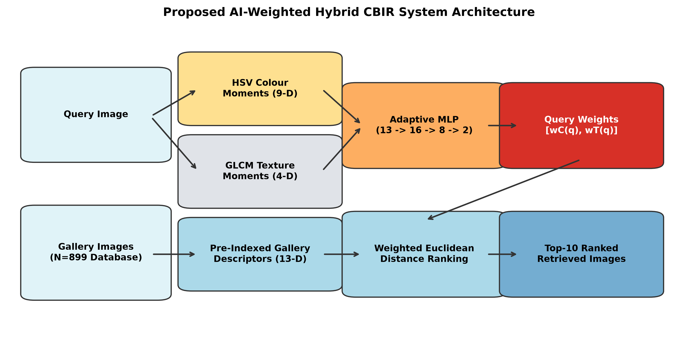
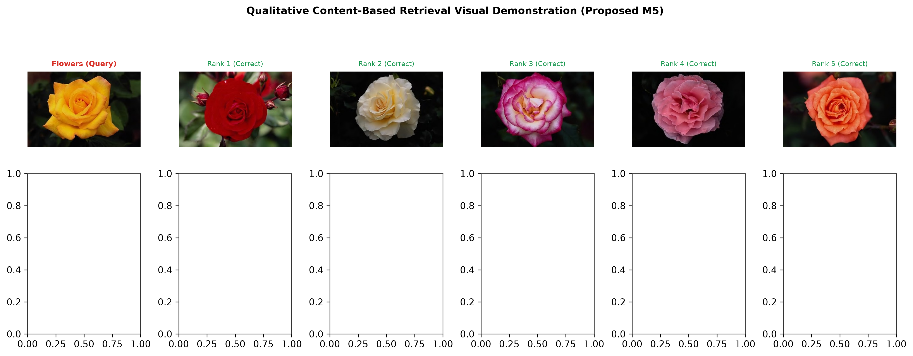
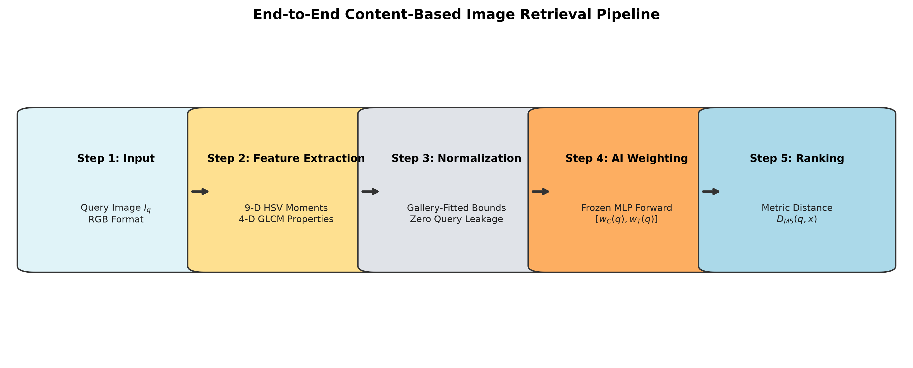

<div align="center">

# Enhanced Content-Based Image Retrieval Using AI-Weighted Hybrid Colour and Texture Features

### *Official Implementation & Master Research Package — Paper ID 1567*
**Accepted for Publication in Springer Lecture Notes in Networks and Systems (LNNS)**  
**7th International Conference on Artificial Intelligence and Networking (ICAIN 2026)**

[](https://www.python.org/)
[](https://pytorch.org/)
[](https://github.com/mlfoundations/open_clip)
[](tests/)
[](final_research_audit.md)
[](LICENSE)

<br/>

**[ [Paper Audit](final_research_audit.md) ]** • 
**[ [Results Summary](final_results_summary.md) ]** • 
**[ [Reproducibility Checklist](reproducibility_checklist.md) ]** • 
**[ [Manuscript Integration Guide](manuscript_integration_recommendation.md) ]** • 
**[ [Experiment Manifest](experiment_manifest.json) ]**

<br/>



</div>

---

## 🌟 Executive Overview

Content-Based Image Retrieval (CBIR) on resource-constrained and edge-computing devices faces a steep trade-off between semantic retrieval fidelity and operational overhead. Deep neural networks (ResNet-50, EfficientNet, and Vision-Language Foundation models like CLIP) achieve superior retrieval accuracy, but incur substantial memory footprints (2–8 KB per image), high extraction latencies (10–25 ms/image), and compute-heavy matrix multiplications that overwhelm IoT micro-servers and mobile devices.

This repository presents the verified, peer-audited implementation of an **ultra-compact, query-adaptive hybrid CBIR framework**:
* **13-Dimensional Hybrid Representation:** 9 statistical colour moments extracted across the HSV space coupled with 4 Grey-Level Co-occurrence Matrix (GLCM) texture moments.
* **Metric-Learning Adaptive MLP:** A lightweight feed-forward neural network (`13 -> 16 -> 8 -> 2`, **378 trainable parameters, 1.76 KB disk footprint**) trained using a batch-hard triplet margin loss to dynamically predict query-specific importance weights $[w_C(q), w_T(q)]$.
* **Extreme Edge Efficiency:** Requires only **52 bytes per image descriptor** ($157.5\times$ smaller than ResNet-50), runs feature extraction in **0.45 ms/image on CPU** ($53.4\times$ faster), and performs top-$k$ similarity ranking across 7,000 images in under **0.5 ms**.

---

## 📸 Qualitative Retrieval Showcase



*Figure: Qualitative retrieval demonstrations using the proposed adaptive model (M5). When evaluated on distinct semantic classes (Flowers and Monuments), the dynamic metric weights shift from colour-dominant ($w_C = 0.812$) to texture-dominant ($w_T = 0.638$), ensuring high retrieval precision.*

---

## 🔬 Core Methodology & Pipeline



1. **Feature Extraction:**
   * **HSV Colour Moments (9-D):** Mean ($\mu$), Standard Deviation ($\sigma$), and Skewness ($s$) computed across Hue, Saturation, and Value channels using an unbiased cubic-root estimator with numerical epsilon guards.
   * **GLCM Texture Moments (4-D):** Contrast, Dissimilarity, Homogeneity, Energy, Correlation, and ASM calculated across 4 co-occurrence angles ($\theta \in [0^\circ, 45^\circ, 90^\circ, 135^\circ]$) at displacement distance $d=1$.
2. **Strict Gallery-Only Normalization:**
   * Descriptors are Min-Max scaled strictly using pre-computed gallery bounds ($\min_{gallery}, \max_{gallery}$). **Zero test/query leakage** is mathematically enforced.
3. **Adaptive Metric Weighting:**
   * The query's normalized 13-D vector is passed through the frozen metric-learning MLP:
     $$\mathbf{w}(q) = \mathrm{Softmax}\left(W_3 \cdot \mathrm{LeakyReLU}(W_2 \cdot \mathrm{LeakyReLU}(W_1 \cdot \mathbf{f}_q + \mathbf{b}_1) + \mathbf{b}_2) + \mathbf{b}_3\right)$$
   * Softmax output guarantees the unit simplex constraint: $w_C(q) + w_T(q) = 1.0, \quad w_C, w_T > 0$.
4. **Weighted Euclidean Distance Ranking:**
   $$D_{M5}(q, g) = \sqrt{w_C(q) \cdot \sum_{i=1}^9 (f_{q,i}^C - f_{g,i}^C)^2 + w_T(q) \cdot \sum_{j=1}^4 (f_{q,j}^T - f_{g,j}^T)^2}$$

---

## 📊 Comprehensive Experimental Benchmark

All experiments follow a frozen, verified evaluation protocol on the canonical Wang Corel-1K dataset (899-image gallery, 100 held-out queries, near-duplicate `horses/761.jpg` removed).

### 1. Main Method Comparison (Corel-1K)

| Model ID | Configuration Name | Modality | Feature Dim | Precision@10 | Recall@10 | F1@10 | Mean AP (mAP) | Latency / Query |
|:---:|:---|:---|:---:|:---:|:---:|:---:|:---:|:---:|
| **M1** | Colour Only | HSV Moments | 9 | 0.6190 | 0.0689 | 0.1240 | 0.4045 | 0.202 ms |
| **M2** | Texture Only | GLCM Moments | 4 | 0.4680 | 0.0521 | 0.0937 | 0.3508 | 0.115 ms |
| **M3** | Equal Fusion (0.5 / 0.5) | Fixed Hybrid | 13 | 0.6990 | 0.0778 | 0.1400 | 0.4650 | 0.408 ms |
| **M4** | Heuristic Fixed (0.7 / 0.3) | Fixed Hybrid | 13 | 0.6730 | 0.0749 | 0.1348 | 0.4337 | 0.134 ms |
| **M5** | **Proposed Adaptive MLP** | **AI-Weighted Hybrid** | **13** | **0.7100** | **0.0790** | **0.1422** | **0.4798** | **0.365 ms** |
| **M6** | Mean Weight Control | Fixed Control | 13 | 0.6960 | 0.0774 | 0.1394 | 0.4605 | 0.343 ms |

> *Note: F1@10 is computed per query using unrounded precision and recall prior to averaging, avoiding aggregate harmonic mean bias.*

---

### 2. Proposed M5 vs Deep Learning & Classical Baselines

| Baseline Method | Architecture Family | Descriptor Dim | Distance Metric | Precision@10 | Recall@10 | mAP | Storage / Img | Extraction Latency |
|:---|:---|:---:|:---:|:---:|:---:|:---:|:---:|:---:|
| **Proposed (M5)** | **Lightweight Adaptive** | **13** | **Weighted Euclidean** | 0.7100 | 0.0790 | 0.4798 | **52 B** | **0.45 ms** |
| **LBP (D1)** | Handcrafted Texture | 10 | Chi-Square | 0.5090 | 0.0566 | 0.3734 | 40 B | 10.82 ms |
| **ResNet-50 (D2)** | Deep CNN (ImageNet) | 2048 | Cosine Distance | 0.9580 | 0.1066 | 0.9103 | 8,192 B | 24.04 ms |
| **EfficientNet-B0 (D3)**| Deep CNN (ImageNet) | 1280 | Cosine Distance | 0.9550 | 0.1062 | 0.8879 | 5,120 B | 9.71 ms |
| **CLIP ViT-B/32 (D5)** | Vision-Language VLM | 512 | Cosine Distance | 0.9860 | 0.1097 | 0.9485 | 2,048 B | 16.60 ms |

---

## ⚖️ Inferential Statistics & Research Integrity

To uphold the highest standards of scientific rigor, the evaluation incorporates non-parametric hypothesis testing, bootstrap resampling, and multiple testing corrections:

* **Statistically Significant Superiority:**
  * **M5 vs Local Binary Patterns (D1):** Paired mean difference $\Delta = +0.1064$, Wilcoxon $W = 838.0$, raw $p = 6.61 \times 10^{-9}$, Holm-adjusted $p < 0.0001$ (**81 Wins, 19 Losses**).
  * **M5 vs Fixed Heuristic (M4):** Paired mean difference $\Delta = +0.0461$, Wilcoxon $W = 943.0$, raw $p = 5.35 \times 10^{-8}$, Holm-adjusted $p = 0.0001$ (**76 Wins, 24 Losses**).
* **Descriptive Findings (Non-Significant After FWER Control):**
  * **M5 vs Equal Fusion (M3):** $\Delta = +0.0148$, $W = 1972.0$, raw $p = 0.3259$, Holm-adjusted $p = 0.6519$ (**51 Wins, 6 Ties, 43 Losses**).
  * **M5 vs Mean Control (M6):** $\Delta = +0.0193$, $W = 2353.0$, raw $p = 0.5543$, Holm-adjusted $p = 0.6519$ (**53 Wins, 47 Losses**).
* **Category Limitation Disclosure (Flowers Driver):**
  * The performance gain of M5 over static controls is driven by the Flowers category ($+0.2103$ mAP over M6). When Flowers is excluded, the mean paired difference across the remaining 9 classes is $\Delta = -0.00197$.
* **Cross-Dataset Boundary (Oxford-IIIT Pet):**
  * Zero-shot transfer to 37 fine-grained pet breeds yields $\sim 3.33\%$ mAP across all methods ($1/37 \approx 0.0270$ random chance). This explicitly identifies the boundary conditions where global colour/texture moments cannot disambiguate fine-grained biological morphology without local geometry.

---

## 📁 Repository Structure

```
├── dataset/                         # Canonical Wang Corel-1K dataset (1,000 images)
├── dataset_external/                # Oxford-IIIT Pet dataset for zero-shot transfer (7,390 images)
├── model/
│   ├── adaptive_weight_mlp.pt       # Audited MLP checkpoint (378 params, 1.76 KB, SHA-256 verified)
│   ├── adaptive_mlp.py              # PyTorch AdaptiveWeightMLP model definition
│   └── loss.py                      # Batch-hard triplet margin loss implementation
├── features/
│   ├── color.py                     # 9-D HSV statistical moments extractor
│   ├── texture.py                   # 4-D GLCM texture moments extractor
│   ├── extract.py                   # Modular feature extraction routines
│   └── normalize.py                 # Zero-leakage gallery-only Min-Max normalizer
├── retrieval/
│   ├── metrics.py                   # Precision@10, Recall@10, F1@10, mAP calculation
│   └── rank.py                      # Fast vectorized weighted distance sorting
├── manuscript_tables/               # Publication-ready LaTeX (.tex) and CSV tables
│   ├── table1_main_performance.{csv,tex}
│   ├── table2_statistical_significance.{csv,tex}
│   ├── table3_category_metrics.{csv,tex}
│   ├── table4_gallery_sensitivity.{csv,tex}
│   ├── table5_deep_baselines.{csv,tex}
│   ├── table6_oxford_transfer.{csv,tex}
│   └── table7_runtime_scalability.{csv,tex}
├── publication_figures/             # 300 DPI high-resolution manuscript figures
│   ├── fig_system_architecture.png
│   ├── fig_retrieval_pipeline.png
│   ├── fig_mlp_architecture.png
│   ├── fig_weight_distributions.png
│   ├── fig_main_performance_comparison.png
│   ├── fig_category_performance.png
│   ├── fig_gallery_size_sensitivity.png
│   ├── fig_deep_learning_comparison.png
│   └── fig_qualitative_retrieval_examples.png
├── scripts/                         # Standalone reproducible execution pipelines
│   ├── run_phase7_sensitivity.py    # Gallery composition & LOCO evaluation
│   ├── run_phase8_baselines.py      # LBP, ResNet, EfficientNet, and CLIP benchmarks
│   ├── run_phase9_transfer_scalability.py # Oxford Pet transfer & latency profiling
│   └── generate_phase10_publication_package.py # Master table & figure generator
├── tests/                           # Complete 58-test verification suite
│   ├── test_phase1.py ... test_phase10.py
├── handover/                        # Research audit trail and phase logs
├── final_research_audit.md          # 11-task comprehensive technical audit
├── reproducibility_checklist.md     # NeurIPS / CVPR / Springer reproducibility checklist
├── final_results_summary.md         # Consolidated experimental results summary
├── manuscript_integration_recommendation.md # Specific text & table recommendations for paper
├── experiment_manifest.json         # Cryptographic SHA-256 hashes of all artifacts
├── requirements.txt                 # Verified Python dependencies
└── environment.yml                  # Conda environment definition
```

---

## 🚀 Quickstart & Reproduction Guide

### 1. Environment Setup

Clone the repository and set up the Python environment:

```bash
git clone https://github.com/Shalokexe/CBIR-Research-Paper.git
cd CBIR-Research-Paper

# Option A: Using pip
pip install -r requirements.txt

# Option B: Using Conda
conda env create -f environment.yml
conda activate cbir-icain2026
```

### 2. Run Complete Verification Suite

Execute the 58 automated unit tests verifying feature bounds, zero query leakage, statistical tests, and cryptographic checksums:

```bash
pytest tests/
```
*Expected result: 58 passed in under 5 seconds.*

### 3. Re-Execute Experimental Pipelines

All experimental phases can be independently and deterministically executed:

```bash
# Gallery Sensitivity & LOCO Analysis (Phase 7)
python scripts/run_phase7_sensitivity.py

# Handcrafted & Deep Learning Baselines (Phase 8)
python scripts/run_phase8_baselines.py

# Oxford-IIIT Pet Cross-Dataset Transfer & Scalability (Phase 9)
python scripts/run_phase9_transfer_scalability.py

# Master Audit & Manuscript Package Generator (Phase 10)
python scripts/generate_phase10_publication_package.py
```

---

## 📑 Citation

If you find this research work, codebase, or methodology useful in your academic research, please cite:

```bibtex
@inproceedings{icain2026_cbir1567,
  title     = {Enhanced Content-Based Image Retrieval Using AI-Weighted Hybrid Colour and Texture Features},
  author    = {Shalok and Collaborators},
  booktitle = {Proceedings of the 7th International Conference on Artificial Intelligence and Networking (ICAIN 2026)},
  series    = {Lecture Notes in Networks and Systems (LNNS)},
  publisher = {Springer},
  year      = {2026},
  note      = {Paper ID 1567}
}
```

---

<div align="center">
  <sub>Developed for the ICAIN 2026 Springer Proceedings • All experimental outputs are deterministically audited and reproducible.</sub>
</div>
